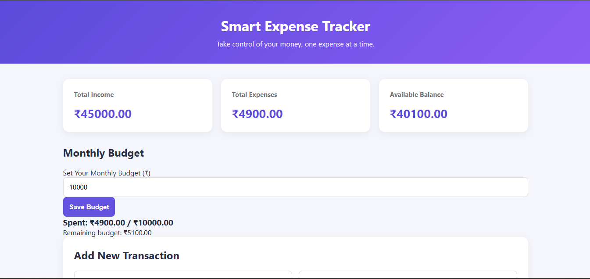

# Smart Expense Tracker 💰

A simple and user-friendly web application to manage daily income and expenses, track spending, and maintain a monthly budget.

## 🌟 Features

- Add income and expense transactions
- View transaction history
- Edit and delete transactions
- Sort transactions by date
- Search transactions
- Filter transactions by type and category
- Set and monitor monthly budgets
- View expense overview through charts
- Export transactions as CSV
- Save transaction data in browser storage

## 🛠️ Technologies Used

- HTML
- CSS
- JavaScript
- Chart.js

## 🚀 Live Demo

[Click here to view Smart Expense Tracker](https://devbybhakti.github.io/smart-expense-tracker/)

## 💻 How to Run

1. Download or clone this repository.
2. Open the project folder.
3. Open `index.html` in your browser.
4. Start managing your income and expenses!

## 📂 Project Structure

```text
smart-expense-tracker/
│
├── index.html
├── style.css
├── script.js
└── README.md
```

## 💡 Project Purpose

The Smart Expense Tracker helps users manage their personal finances by recording transactions, monitoring expenses, and tracking monthly budgets through a simple dashboard.

## 👩‍💻 Developer

**Bhakti Ranmale**

Information Technology Student
## 📸 Project Screenshot


